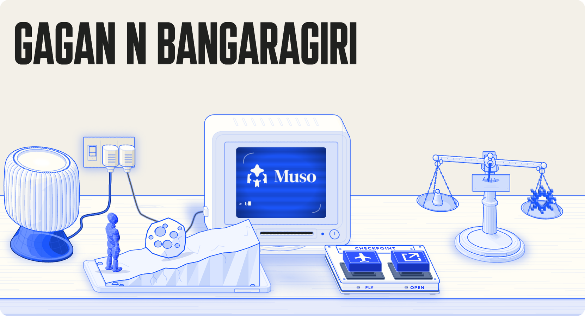

<a href="https://gaganb.page/"><picture><source media="(prefers-color-scheme: dark)" srcset="assets/desk-dark.png"></picture></a>

I'm Gagan, or Geg, an AI engineer in Bangalore. I turn questions into things people can actually use, and keep them on [my desk](https://gaganb.page/).

         

### Things you can open

`FIG. 01` **[Checkpoint](https://github.com/BurntDosa/Checkpoint)** · Shipped Project memory that stays with the code

`FIG. 02` **[Sisyphus](https://github.com/BurntDosa/Sisyphus-Stats)** · Shipped A ranked-game chronicle for a Discord squad

`FIG. 03` **[Identité](https://github.com/BurntDosa/Identite)** · Beta on TestFlight Indian IDs and bank cards as copyable text, on iPhone, iPad and Mac

`FIG. 04` **[Research Assistant](https://github.com/BurntDosa/Research-Assistant)** · Archived A research workflow that learns from the papers you choose

 

 Thanks for stopping *by*.
